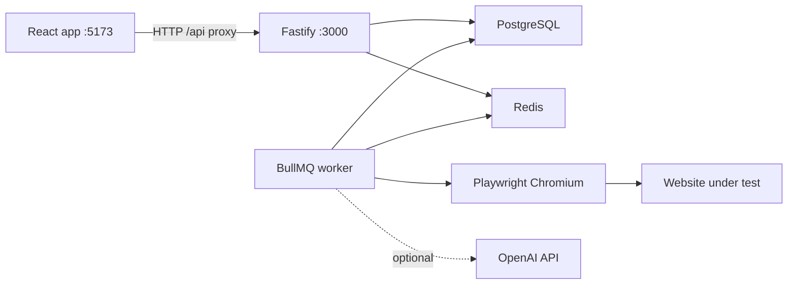

# 1. Project overview

## What the application does

Website Analyzer opens a live website in a real browser, checks the pages it can reach, and stores the result under a site name. A person can run three kinds of check:

- **Landing page only** — one URL, with counts for links, images, forms, and APIs found on that page.
- **Full website** — crawl reachable pages and score health. This mode does not take the screenshot set.
- **Screenshot every page** — one desktop image per page, in visit order, plus a downloadable flow PDF. Other QA checks are skipped for that mode.

The scanner also records bugs, reports, console errors, failed network calls, accessibility, SEO, security, performance, and functional findings when those checks are turned on.

Source: `apps/web/src/i18n/en.ts`, `packages/shared/src/schemas.ts`, `apps/api/src/workers/pipeline.ts`.

## Business problem

Teams need a local record of what a website actually does when a browser visits it: broken links, failed APIs, health scores, screenshots, and a page flow. The app keeps that record in PostgreSQL instead of relying on a one-off browser session.

## User roles

| Role | What the code does |
| --- | --- |
| Registered account | Name, email, and password. The web app shows the scanner only after login. Registration itself does not open the dashboard. |
| Anonymous visitor | Can open the landing page, login, and register. App routes redirect to `/login` when `localStorage` has no user. |
| Local scanner owner | Scans, sites, bugs, and reports are stored on a seeded user `local@qa-scanner.local`, not on the account that logged in. |

There is no role or permission table. **Not verified:** any admin role.

Source: `apps/api/src/services/local-context.ts`, `apps/web/src/components/layout/AppLayout.tsx`, `apps/web/src/pages/AuthPages.tsx`.

## Major modules

- Landing, login, and register pages.
- Dashboard, sites, scans, bugs, reports, settings, and scan compare.
- Fastify API and a BullMQ worker that runs Playwright.
- PostgreSQL for records and file bytes.
- Redis for the job queue and rate limiting.
- Optional OpenAI analysis when `OPENAI_API_KEY` is set.

## Overall workflow

1. A person logs in. The browser stores a session token.
2. They start a scan with a site name and URL.
3. The API creates or reuses a `Project` by name, inserts a `Scan`, and enqueues a job.
4. The worker crawls and analyzes, or captures screenshots only.
5. Results, bugs, reports, and file bytes are written to PostgreSQL.
6. The UI polls progress and shows scores, pages, bugs, and downloads.

## How the parts communicate

The Vite dev server proxies `/api` to `http://localhost:3000` (`apps/web/vite.config.ts`).
