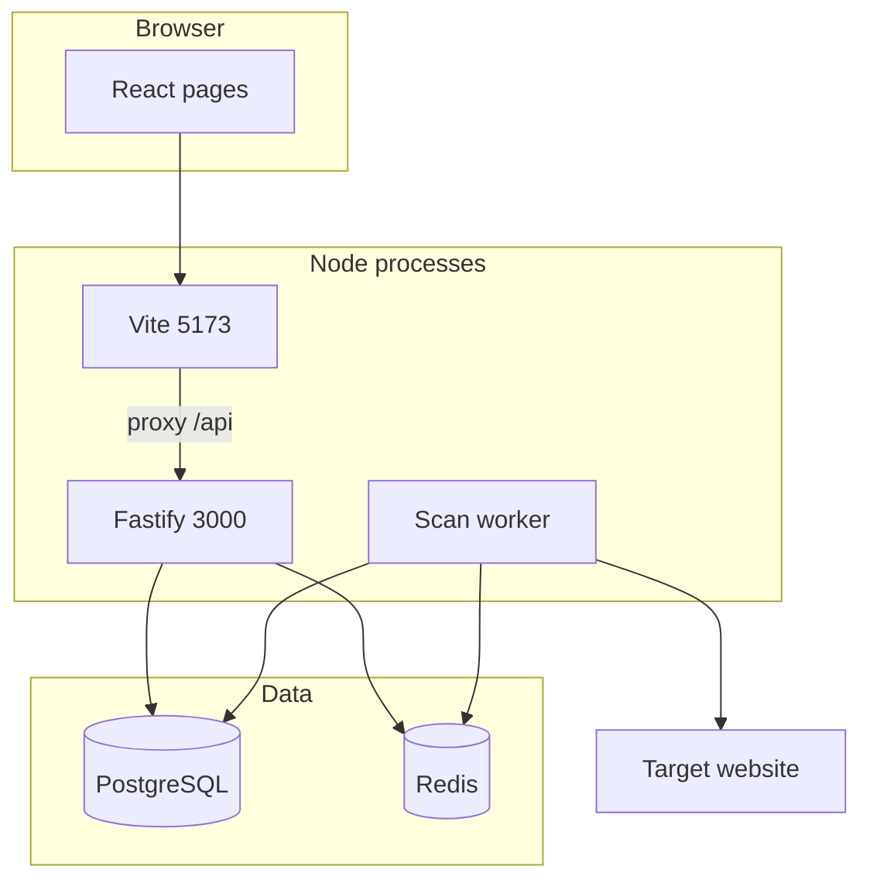

# 4. System architecture

## Runtime processes

`npm run dev` starts three processes (`package.json`):

1. Vite web server.
2. Fastify API (`apps/api/src/index.ts`).
3. Worker (`apps/api/src/worker.ts`).

PostgreSQL and Redis are external. They are not started by `npm run dev`.

## Request path

1. The React page calls `api.*` in `apps/web/src/api/client.ts`.
2. `fetch` uses a relative `/api/...` URL. In development Vite forwards it to port 3000.
3. Fastify validates some bodies with Zod (`packages/shared/src/schemas.ts`) and reads or writes Prisma models.
4. Creating a scan also adds a BullMQ job (`apps/api/src/lib/queue.ts`).
5. The worker runs `pipeline.ts`, launches Chromium, and writes pages, bugs, scores, and `FileBlob` rows.

## Authentication boundary

The React layout checks `localStorage` and redirects to `/login`. The scan, bug, report, and evidence HTTP handlers do not read the `Authorization` header. See [Authentication](10-authentication-and-authorization.md).

## Data ownership

`getLocalContext()` in `apps/api/src/services/local-context.ts` loads or creates `local@qa-scanner.local` and a `Default Project`. Site names become additional `Project` rows. Logged-in accounts do not replace that local owner.

## File path

Generated screenshots, videos, traces, and reports are written to `STORAGE_ROOT` and then copied into `FileBlob.bytes` by `ingestStoredFile` (`apps/api/src/lib/storage.ts`, called from `apps/api/src/workers/pipeline.ts`). The disk file is deleted after a successful insert. `saveBuffer` implements the same idea and has no caller in `apps/api/src`.
