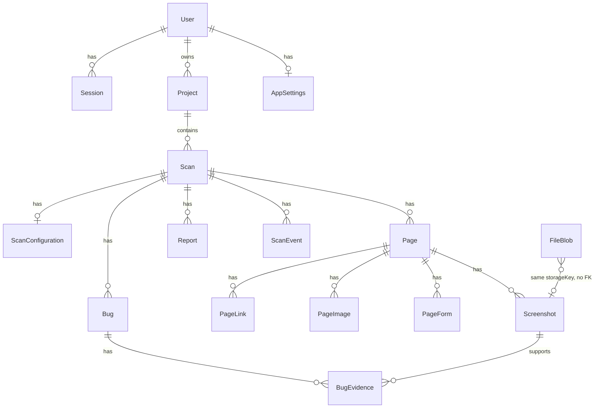

# 7. Database documentation

Source of truth: `prisma/schema.prisma`. Provider: PostgreSQL. IDs are `cuid` strings unless noted. Prisma `String?` and `Int?` are nullable. Fields without `?` are required.

No separate NoSQL database exists.

## Entity diagram

`FileBlob` is not a Prisma relation to `Screenshot`. Both store `storageKey`. The link is by string, not a foreign key.

## Tables

### User

Account or the local scanner owner.

| Field | Type | Nullable | Notes |
| --- | --- | --- | --- |
| id | String | no | Primary key, cuid |
| email | String | no | Unique |
| name | String | no | |
| passwordHash | String | yes | `scrypt:salt:hash`. Null on the seeded local user if no password was set |
| createdAt | DateTime | no | Default now |
| updatedAt | DateTime | no | |

Written by `routes/auth.ts` and `services/local-context.ts`.

### Session

| Field | Type | Nullable | Notes |
| --- | --- | --- | --- |
| id | String | no | PK |
| token | String | no | Unique. Random 32 bytes hex |
| userId | String | no | FK User, cascade delete |
| createdAt | DateTime | no | |
| expiresAt | DateTime | no | 14 days in `routes/auth.ts` |

Index: `userId`.

### Project

A site folder such as the name entered on the scan form.

| Field | Type | Nullable | Notes |
| --- | --- | --- | --- |
| id | String | no | PK |
| name | String | no | Not unique in the schema |
| userId | String | no | FK User, cascade |
| createdAt, updatedAt | DateTime | no | |

Index: `userId`. Read and written by site and scan routes.

### AppSettings

One row per user (`userId` unique). Defaults match `.env.example` scan defaults, plus `maxScreenshotBytes` default 10485760, `respectRobotsTxt` true, `aiEnabled` true. `retentionDays` default 30 is stored here. No API worker reference to that column was found.

### Scan

One run against a URL.

Required: `id`, `projectId`, `url`, `host`, `status` (default `QUEUED`), counters default 0, timestamps `createdAt`/`updatedAt`.

Nullable scores: `overallScore`, `performanceScore`, `accessibilityScore`, `seoScore`, `securityScore`, `functionalScore`, `visualScore`, `technicalScore`, `scoreBreakdown`, `errorMessage`, `startedAt`, `completedAt`, `cancelledAt`.

Status enum: `QUEUED`, `INITIALIZING`, `CRAWLING`, `SCANNING`, `ANALYZING`, `VERIFYING`, `GENERATING_REPORT`, `COMPLETED`, `FAILED`, `CANCELLED`, `PAUSED`.

Indexes: `projectId`, `status`, `createdAt`, `url`, `host`.

### ScanConfiguration

One per scan (`scanId` unique). Holds `maxPages`, `maxDepth`, `viewport`, booleans for screenshots, video, AI, functional, accessibility, performance, SEO, and security, plus timeout, delay, concurrency, robots flag, `testMode`, `browserEngine`, and optional `coverage` string (`LANDING`, `FULL`, or `SCREENSHOTS` when set by the API).

### Page

One discovered URL. Unique `(scanId, normalizedUrl)`. Status enum: `DISCOVERED`, `QUEUED`, `SCANNING`, `SCANNED`, `FAILED`, `SKIPPED`. Stores title, meta, HTTP status, timing, headings JSON, cookie names/flags JSON, HTTPS and TLS JSON. Nullable analysis fields are optional.

### PageLink, PageImage, PageForm, PageElement

Child rows of `Page`, cascade delete.

- **PageLink:** `href`, optional `text`, `isInternal`, optional `statusCode` and `error`, `isBroken` default false.
- **PageImage:** `src` URL string, optional `alt`, status, natural size, `isBroken`. This is metadata about an image on the target site, not the image bytes.
- **PageForm:** optional `action` and `method`, `fieldCount`, `fieldsJson`, `hasSubmit`.
- **PageElement:** `type`, optional selector, text, name, role, href, `visible` default true, `bounds`, `risk`.

### ConsoleError and NetworkError

Tied to `Scan`, optional `Page` (`onDelete: SetNull`). Both have `fingerprint`. Network rows store `requestUrl`, `method`, optional status, resource type, initiator, and error. These are the API-failure records.

### PerformanceMetric

One per page (`pageId` unique). Timing and size fields are nullable. `score` is nullable.

### AccessibilityIssue, SEOIssue, SecurityIssue

`pageId`, `rule`, `severity`, `message`, `fingerprint`. Accessibility also has optional `selector`.

### Bug

`bugNumber`, `scanId`, `title`, `description`, `category`, `severity`, `priority`, `status` default `OPEN`, `url`, `affectedUrls` JSON, `fingerprint`, `occurrences` default 1, `verified` default false, `source` default `"rule"`. Unique `(scanId, fingerprint)`.

Categories include `BROKEN_LINK`, `BROKEN_IMAGE`, `JAVASCRIPT`, `NETWORK`, `SEO`, `SECURITY`, and others listed in the enum.

### BugEvidence

Links a bug to an optional screenshot, video, or trace. `path` and `metadata` are optional.

### FileBlob

| Field | Type | Nullable | Notes |
| --- | --- | --- | --- |
| id | String | no | PK |
| storageKey | String | no | Unique. Example shape `screenshots/{scanId}/{file}` |
| mimeType | String | no | |
| bytes | Bytes | no | PostgreSQL `bytea`. The file content |
| byteSize | Int | no | |
| createdAt | DateTime | no | |

Written by `upsertFileBlob` in `apps/api/src/lib/storage.ts`.

### Screenshot, Video, Trace

Metadata plus `storageKey` and `filePath`. Screenshot `mimeType` defaults to `image/png`. Video defaults to `video/webm`. `pageId` on Screenshot is nullable (`onDelete: SetNull`).

### Report

`scanId`, `format` (`HTML`, `PDF`, `XLSX`, `JSON`, `CSV`), `storageKey`, `filePath`, `fileName`.

### ScanEvent

`scanId`, `type`, `message`, optional `payload` JSON. Used for progress.

## Business rules visible in schema and code

- Deleting a user cascades projects, settings, and sessions.
- Deleting a scan cascades pages, bugs, reports, events, and configuration.
- Deleting a page sets screenshot `pageId` to null (`onDelete: SetNull`). The screenshot row stays.
- `DELETE /api/scans/:id` then calls `removeScanFiles`, which deletes `FileBlob` rows whose key matches `screenshots|videos|traces|reports/{scanId}/%` and removes that directory on disk. It does not delete `Screenshot`, `Video`, or `Trace` rows. Those rows can remain after the bytes are gone.
- `resetProjectData` deletes screenshot, video, and trace rows and every `FileBlob` row.
