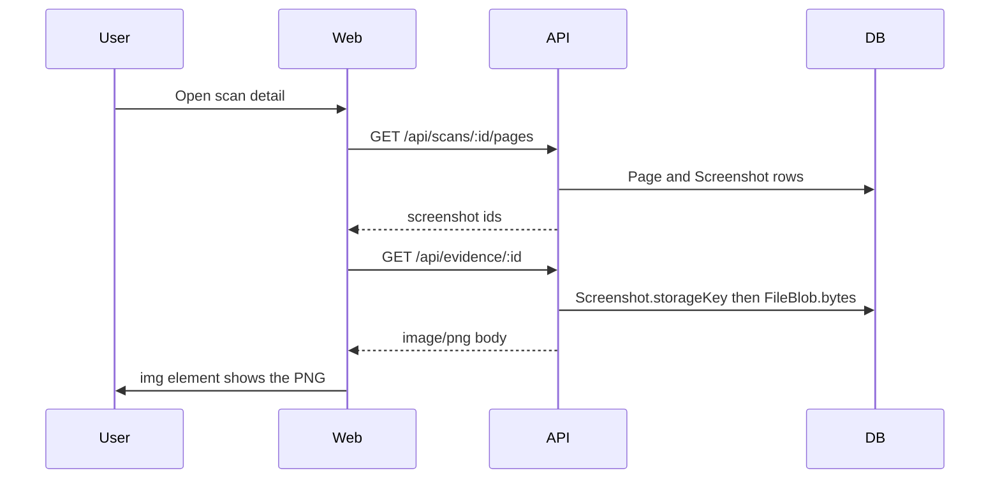

# 9. Image and file storage

## What this application stores

Users do not upload product photos through a form. The files in this system are **generated evidence**:

- PNG screenshots taken by Playwright.
- WebM videos of failed functional scenarios when video is enabled.
- Playwright traces.
- Report files (HTML, PDF, XLSX, JSON, CSV).
- A flow PDF built from screenshot slides.

`PageImage` stores the **URL** (`src`) of an image found on the website under test. It does not store that image’s bytes.

## A. How a screenshot is produced

There is no `<input type="file">` in the scan form.

1. The user starts a scan in `ScanForm.tsx`.
2. `POST /api/scans` receives JSON, not `multipart/form-data`.
3. `captureFullPageScreenshot` in `apps/api/src/workers/pipeline.ts` runs when `captureScreenshots` is true, or when coverage is `SCREENSHOTS`.
4. `screenshotPage` in `packages/browser/src/index.ts` calls Playwright `page.screenshot({ path, fullPage: true, type: "png" })`. The PNG is written to a path under `STORAGE_ROOT`.
5. `ingestStoredFile` in `apps/api/src/lib/storage.ts` reads that file, upserts `FileBlob`, then deletes the disk file.
6. `prisma.screenshot.create` stores `pageId`, `kind`, `storageKey`, and `filePath`. `mimeType` defaults to `image/png` in the schema. Width and height are optional and are not set in this create call.

`saveBuffer` in `storage.ts` does the same disk-then-blob-then-unlink sequence, but nothing in `apps/api/src` calls it. The worker uses `ingestStoredFile`.

Screenshot coverage (`screenshotViewportsFor` in `packages/visual-engine/src/index.ts`) captures only the `DESKTOP` viewport. Other coverages follow the configured viewport mode and can capture `DESKTOP`, `TABLET`, `MOBILE`, `WIDE`, `LAPTOP`, or `COMPACT`.

Storage key from `scanFileKey`, using a fictional scan id and page id:

`screenshots/scan_example/page_example-DESKTOP-full.png`

`login.png` is not that key. The zip download renames files. See section E.

Validation that exists:

- Storage keys reject `..` and absolute paths (`assertSafeKey`).
- File names are stripped to `[a-zA-Z0-9._-]` in `scanFileKey`. `../evil.pdf` becomes `.._evil.pdf` (`storage.test.ts`).

`AppSettings.maxScreenshotBytes` defaults to 10485760 and `settingsSchema` accepts 100000–50000000. A search of `apps/api/src` found no read of that column. The pipeline does not reject a PNG for size.

Not implemented for these generated files:

- An end-user upload form or MIME allow-list.
- An EXIF strip step. No EXIF library is a dependency of this path. **Not verified:** whether Playwright’s PNG contains EXIF.
- Conversion to WebP.
- A resize of the full-page PNG. `packages/evidence-engine` uses Jimp only for bug annotation and crop (`annotateScreenshot`, `cropScreenshot`).

## B. Where bytes live

Primary store: PostgreSQL table `FileBlob`, column `bytes` (`bytea`).

`STORAGE_ROOT` is `STORAGE_DIR` when that variable is non-empty, otherwise `<repo>/storage` (`apps/api/src/config.ts`).

`ingestStoredFile`:

1. Reads the Playwright file.
2. `INSERT ... ON CONFLICT ("storageKey") DO UPDATE` into `FileBlob` (`upsertFileBlob`). The update replaces `mimeType`, `bytes`, and `byteSize`. It does not change `createdAt`.
3. Deletes the disk file. Unlink errors are ignored.
4. If read or insert throws, the function returns `null` and leaves the disk file in place. `captureFullPageScreenshot` still creates the `Screenshot` row after that call, without checking the return value.

There is no object-storage SDK in `apps/api/package.json`. No S3, GCS, or Azure bucket is configured.

Key shape from `scanFileKey`:

`screenshots/{scanId}/{safeFileName}`

`videos/`, `traces/`, and `reports/` use the same pattern.

## C. Reference versus bytes

| Stored in | Table.field | Example value (illustrative) |
| --- | --- | --- |
| Bytes | `FileBlob.bytes` | binary PNG |
| Lookup key | `FileBlob.storageKey` | `screenshots/scan_example/page_example-DESKTOP-full.png` |
| Pointer used by the UI | `Screenshot.id` | `GET /api/evidence/:id` |
| Path column | `Screenshot.filePath` | absolute path under `STORAGE_ROOT` at write time. The file is normally deleted after ingest |

The illustrative key is an example of the pattern in `scanFileKey`, not a row from a live database.

The UI does not build a public `/uploads/...` URL. It calls `GET /api/evidence/:screenshotId`.

## D. Retrieval

`readStoredFile` order:

1. `SELECT bytes FROM FileBlob WHERE storageKey = ?`.
2. If missing, read the path under `STORAGE_ROOT`, insert a blob, and delete the disk file.

Response headers in `streamStored`: `Content-Type` and `Cache-Control: private, max-age=3600`. No signed URL. No CDN configuration is present in the API package.

If the blob and the disk file are both missing, the handler returns `404` `{ error: "File missing" }`.

## E. Replace, zip names, and delete

- A new scan uses a new `scanId` in the key. It does not overwrite another scan’s keys.
- `upsertFileBlob` replaces bytes when the same `storageKey` is written again.
- `GET /api/scans/:id/screenshots.zip` reads blob bytes and builds a zip in memory (`routes/scans.ts`, `lib/zip.ts`). For coverage `SCREENSHOTS`, every included PNG goes in one folder named `screenshots/`, and the file name comes from `screenshotFileName(flowName)` in `packages/shared/src/page-flow.ts` (for example `login.png`, `register.png`). That name is the zip entry only. The database key stays `{pageId}-{kind}-full.png`.
- The zip includes kinds `DESKTOP`, `TABLET`, `MOBILE`, `WIDE`, `LAPTOP`, `COMPACT`, and `original`. It skips `annotated`.
- `attachAnnotated` writes three files: `-orig.png`, `-ann.png`, and, when a box exists, `-crop.png`. Only original and annotated get `Screenshot` rows. The crop is ingested into `FileBlob` and has no screenshot row, so the UI and the zip do not list it. `removeScanFiles` still deletes it because the key starts with `screenshots/{scanId}/`.
- `DELETE /api/scans/:id` deletes the `Scan` row, then calls `removeScanFiles`. That deletes matching `FileBlob` rows and the scan directory on disk. It does not delete `Screenshot`, `Video`, or `Trace` rows. `Screenshot.pageId` is `onDelete: SetNull`, so those rows remain with a null page after the pages cascade away. A later `GET /api/evidence/:id` can find the row and then return `404` `{ error: "File missing" }` because the blob is gone.
- `POST /api/settings/reset-data` does delete screenshot, video, and trace rows, then `DELETE FROM "FileBlob"` (`services/reset-data.ts`).
- There is no thumbnail set. Extra images are the annotated PNG, the crop PNG, and functional before/after PNGs. Jimp re-encodes annotation and crop. The full-page capture is the Playwright PNG.
- Functional checks always ingest `{pageId}-func-before.png` and `{pageId}-func-after.png`. `Screenshot` rows with kind `before` and `after` are created only when a functional check fails, and those kinds are excluded from the zip. If nothing fails, the two blobs have no screenshot row until the scan is deleted.

## F. Security

- Path traversal is blocked in `assertSafeKey`.
- Evidence URLs are unauthenticated. Anyone who can reach the API and knows or guesses an id can download the file.
- `Cache-Control` is `private`, which tells shared caches not to store the response. The browser may still cache it for one hour.
- Target-site passwords are not written to `FileBlob`.
- Cookie **values** are redacted from stored network logs. See `docs/playwright.md` in this folder.

## G. Example record

Illustrative, not a production row:

`Screenshot`

- `id`: `scr_example`
- `pageId`: `page_example`
- `kind`: `DESKTOP`
- `storageKey`: `screenshots/scan_example/page_example-DESKTOP-full.png`
- `filePath`: absolute path under `STORAGE_ROOT` at write time
- `mimeType`: `image/png`

`FileBlob`

- `storageKey`: `screenshots/scan_example/page_example-DESKTOP-full.png`
- `mimeType`: `image/png`
- `byteSize`: `482113` (illustrative size, not a measured file)
- `bytes`: PNG binary

The browser displays it with `GET /api/evidence/scr_example` (`ScanDetailPage.tsx`, `ScreenshotFlow.tsx`, `PageDetailPage.tsx`, `BugsPage.tsx`, `BugDetailPage.tsx`).

A screenshot-coverage zip entry for a page whose flow name is Login is `screenshots/login.png`. That string is not stored in `Screenshot.storageKey`.
