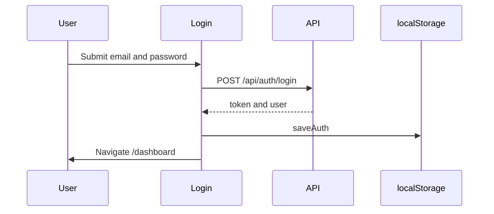

# 10. Authentication and authorization

## What exists

| Capability | Status |
| --- | --- |
| Register with name, email, password | Implemented in `routes/auth.ts` and `AuthPages.tsx` |
| Login | Implemented |
| Password hashing | scrypt, 16-byte salt, 32-byte hash, stored as `scrypt:salt:hash` (`lib/password.ts`) |
| Session token | 32 random bytes, hex, table `Session`, 14-day `expiresAt` |
| Client storage | `localStorage` keys `qa-auth-token` and `qa-auth-user` |
| Request header | `Authorization: Bearer <token>` from `api/client.ts` when a token exists |
| Logout | `POST /api/auth/logout` deletes that session. The UI also clears `localStorage` |
| UI gate | `AppLayout` redirects to `/login` when no stored user |
| Register does not enter the app | Register navigates to `/login` and does not call `saveAuth` |
| Checkbox on register | Required in the UI before submit |

## What is absent

- JWT access tokens and refresh tokens.
- HTTP-only auth cookies. CORS sets `credentials: true`, but the web app uses `localStorage`, not a cookie session.
- Email verification.
- Password reset.
- Roles, permissions, and admin accounts.
- Server-side checks on scan, bug, report, site, dashboard, settings, and evidence routes.

`GET /api/auth/me` returns `{ user: null }` for a bad token instead of HTTP 401.

## Important split

Logging in proves an account exists and lets the React app render. Scan data is still attached to `local@qa-scanner.local` by `getLocalContext()`. Two people who register do not receive separate scan databases in the current API.

The register API still creates a `Session` and returns `token`. The current web client discards it. A different client could store that token.

## Password for the site under test

The scan form can send `loginUsername` and `loginPassword` for the website being tested. Those values are placed on the BullMQ job (`lib/queue.ts`). They are not columns on `Scan`. They can sit in Redis until the job finishes or is removed (`removeOnComplete` / `removeOnFail` keep up to 50 jobs).

## Frontend sequence

