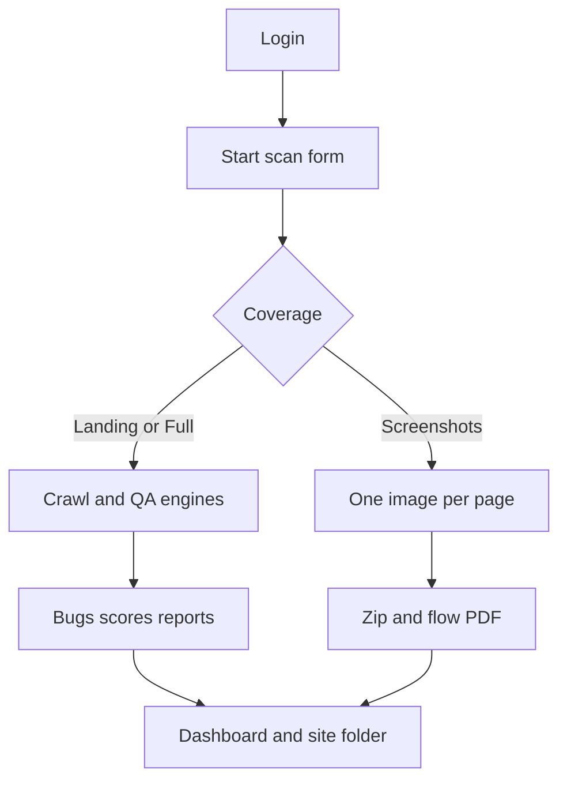

# 11. Business logic and workflows

## Start a scan

1. `ScanForm` requires a site name and an http(s) URL.
2. `POST /api/scans` validates with `createScanSchema`.
3. `services/sites.ts` reuses or creates a `Project` for that name.
4. A `Scan` and `ScanConfiguration` are inserted. Status starts as `QUEUED`.
5. Coverage changes behavior in the route before the job runs:
   - `SCREENSHOTS`: desktop viewport, screenshots on, other QA flags off, concurrency 1.
   - `FULL`: screenshots forced off.
6. A BullMQ job is added.
7. The worker updates status through `CRAWLING`, `SCANNING`, `ANALYZING`, and `GENERATING_REPORT`, then `COMPLETED` or `FAILED`.
8. The scan page polls `GET /api/scans/:id/progress` and opens `EventSource` on `GET /api/scans/:id/events` (`apps/web/src/hooks/useScanEvents.ts`). That route is a server-sent event stream, not a JSON list.

## Screenshot-only flow

When coverage is `SCREENSHOTS`, the worker visits pages and stores one desktop PNG each. The database key looks like `screenshots/{scanId}/{pageId}-DESKTOP-full.png`. Names such as Login and Dashboard come from `packages/shared/src/page-flow.ts` (browser copy: `apps/web/src/lib/page-flow.ts`) and are used as zip entry names (`login.png`), not as storage keys. `GET /api/scans/:id/flow.pdf` builds a PDF whose first page is a flow diagram and whose later pages are the images, up to 60 slides. The PDF route rejects scans that are not screenshot coverage.

## Full and landing checks

The worker uses the crawler, parser, and engines for links, images, forms, console errors, network errors, accessibility, SEO, security, performance, and functional checks when those flags are on. `health-engine` rolls category scores into `Scan` score columns. `bug-writer` deduplicates with `(scanId, fingerprint)`.

Landing coverage limits the crawl to the submitted URL (depth 0 / one page). Confirm the exact depth assignment in `routes/scans.ts` when changing limits. The UI copy in `i18n/en.ts` states that landing scans one URL.

## Pause, cancel, restart

`POST` routes under `/api/scans/:id/` update status and the queue. Restart keeps the same project. Exact status transitions are in `routes/scans.ts`.

## API replay

Failed network calls can be requested again with `POST /api/scans/:id/replay-apis` or `POST /api/bugs/:id/replay-api`. Selection logic is in `lib/failed-apis.ts`. Replay uses `lib/http-check.ts`. It does not run exploit payloads.

## Sites

The sites list shows projects that already have scans. Opening a site shows that project’s scans, reports, and bugs (`routes/sites.ts`, `pages/SitePage.tsx`).

## Reports

When a scan finishes, `report-engine` writes HTML, PDF, spreadsheet, JSON, and CSV as configured by the pipeline. Each file is a `Report` row plus a `FileBlob`. Download reads the blob.

## Reset

`POST /api/settings/reset-data` clears stored scan data through `services/reset-data.ts`. It is rate limited.

